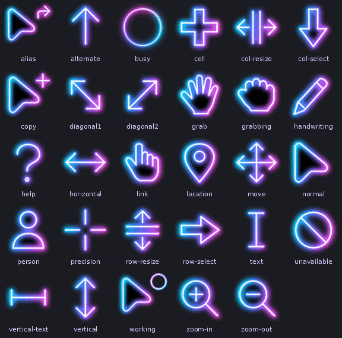
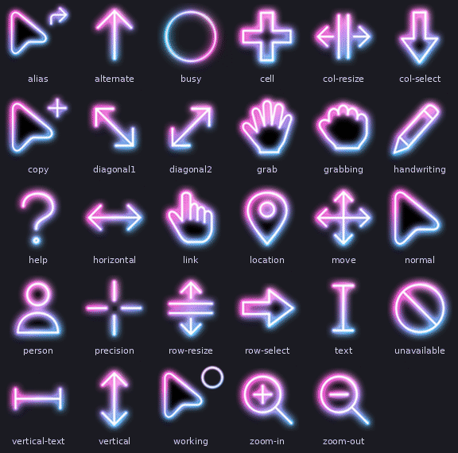
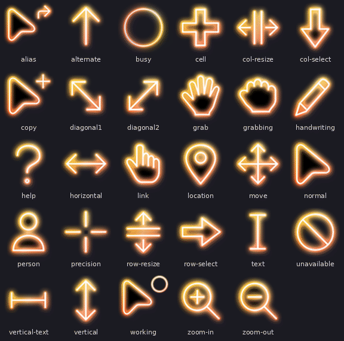
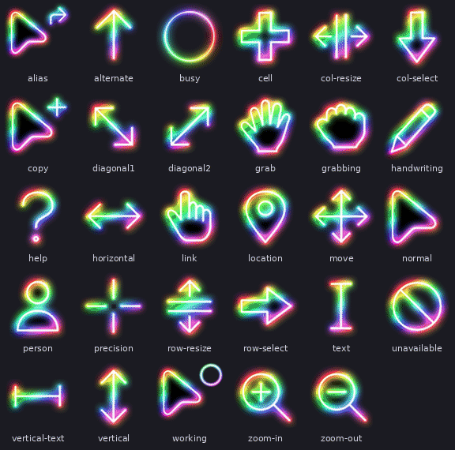
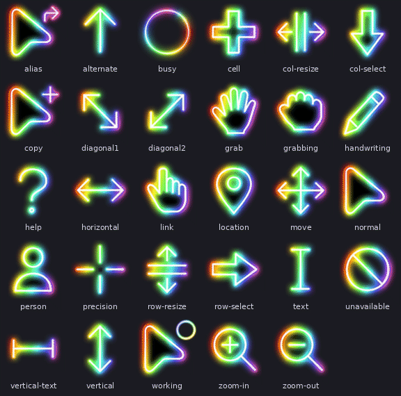
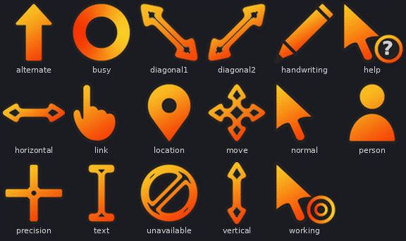

# Alessandro Cursores

Cursores animados para Windows (`.ani`) criados e adaptados por **Alessandro Lobo**. Todos têm frames em 5 tamanhos (128, 64, 48, 32 e 16 px), pontos ativos ajustados e um instalador `.bat` próprio por conjunto.

## Conjuntos

| Pasta | Visual | Cursores |
|---|---|---|
| [Alessandro Galaxy Neon](#alessandro-galaxy-neon) | Cores originais do Galaxy (ciano, azul, violeta e magenta) com a animação lenta do pacote original, ciclo de cerca de 3 s | 29 |
| [Alessandro Galaxy Neon Rapido](#alessandro-galaxy-neon-rapido) | Mesmo visual neon do conjunto anterior, mas com o ciclo acelerado para 0,67 s | 29 |
| [Alessandro Galaxy Neon Onda](#alessandro-galaxy-neon-onda) | Mesmas cores neon, com uma onda de cor que desce de cima para baixo passando por todo o cursor | 29 |
| [Alessandro Galaxy Laranja](#alessandro-galaxy-laranja) | Brilho laranja e amarelo animado no mesmo padrão de onda | 29 |
| [Alessandro Galaxy Arco-iris](#alessandro-galaxy-arco-iris) | Espectro arco-íris completo deslizando pelo cursor | 29 |
| [Alessandro Galaxy Arco-iris Rapido](#alessandro-galaxy-arco-iris-rapido) | Cores do arco-íris sobre a animação do Neon Rapido, com o ciclo de 0,67 s | 29 |
| [Alessandro Clausing Laranja](#alessandro-clausing-laranja) | Estilo Orange Gradient: contorno escuro com preenchimento em gradiente laranja animado | 17 |

## Alessandro Galaxy Neon

Cores originais do Galaxy (ciano, azul, violeta e magenta) com a animação lenta do pacote original, ciclo de cerca de 3 s.

Pasta: [`Alessandro Galaxy Neon/`](Alessandro%20Galaxy%20Neon/) · Instalador: `Instalar Alessandro Galaxy Neon.bat`

## Alessandro Galaxy Neon Rapido

Mesmo visual neon do conjunto anterior, mas com o ciclo acelerado para 0,67 s.

Pasta: [`Alessandro Galaxy Neon Rapido/`](Alessandro%20Galaxy%20Neon%20Rapido/) · Instalador: `Instalar Alessandro Galaxy Neon Rapido.bat`

## Alessandro Galaxy Neon Onda

Mesmas cores neon, com uma onda de cor que desce de cima para baixo passando por todo o cursor. 8 frames, ciclo de 0,67 s.

Pasta: [`Alessandro Galaxy Neon Onda/`](Alessandro%20Galaxy%20Neon%20Onda/) · Instalador: `Instalar Alessandro Galaxy Neon Onda.bat`

## Alessandro Galaxy Laranja

Brilho laranja e amarelo animado no mesmo padrão de onda. 8 frames, ciclo de 0,67 s.

Pasta: [`Alessandro Galaxy Laranja/`](Alessandro%20Galaxy%20Laranja/) · Instalador: `Instalar Alessandro Galaxy Laranja.bat`

## Alessandro Galaxy Arco-iris

Espectro arco-íris completo deslizando pelo cursor. 8 frames, ciclo de 0,67 s.

Pasta: [`Alessandro Galaxy Arco-iris/`](Alessandro%20Galaxy%20Arco-iris/) · Instalador: `Instalar Alessandro Galaxy Arco-iris.bat`

## Alessandro Galaxy Arco-iris Rapido

Cores do arco-íris (vermelho ao magenta) sobre a animação do Neon Rapido, em que o gradiente corre pelo contorno do cursor. 20 frames, ciclo de 0,67 s.

Pasta: [`Alessandro Galaxy Arco-iris Rapido/`](Alessandro%20Galaxy%20Arco-iris%20Rapido/) · Instalador: `Instalar Alessandro Galaxy Arco-iris Rapido.bat`

## Alessandro Clausing Laranja

Estilo Orange Gradient: contorno escuro com preenchimento em gradiente laranja animado. Conjunto compacto com os 17 cursores do Windows.

> **Agradecimento:** ao **Henrique Clausing**, que teve a ideia inicial e criou o padrão que serviu de base para este conjunto, de forma profissional. Sem o trabalho dele este estilo não existiria.

Pasta: [`Alessandro Clausing Laranja/`](Alessandro%20Clausing%20Laranja/) · Instalador: `Instalar Alessandro Clausing Laranja.bat`

## Como instalar

1. Baixe ou clone o repositório e entre na pasta do conjunto desejado.
2. Execute `Instalar <nome do conjunto>.bat` (duplo clique). O instalador não precisa de administrador.
3. Escolha **1** para instalar. Os cursores são copiados para `%LOCALAPPDATA%` e o esquema aparece em **Configurações > Bluetooth e dispositivos > Mouse > Ponteiro do mouse**, com o mesmo nome da pasta.
4. Escolha **2** para voltar ao padrão do Windows. Isso também remove os arquivos copiados e o esquema registrado.

O instalador só altera `HKCU\Control Panel\Cursors` e a pasta em `%LOCALAPPDATA%`, sem rede e sem arquivos do sistema. O `.bat` precisa ficar na mesma pasta dos `.ani`.

## Mapeamento dos cursores

| Arquivo | Função no Windows |
|---|---|
| `normal.ani` | Seta (Arrow) |
| `help.ani` | Ajuda (Help) |
| `working.ani` | Em segundo plano (AppStarting) |
| `busy.ani` | Ocupado (Wait) |
| `precision.ani` | Precisão (Crosshair) |
| `text.ani` | Texto (IBeam) |
| `handwriting.ani` | Escrita (NWPen) |
| `unavailable.ani` | Indisponível (No) |
| `vertical.ani` | Redimensionar vertical (SizeNS) |
| `horizontal.ani` | Redimensionar horizontal (SizeWE) |
| `diagonal1.ani` | Diagonal \ (SizeNWSE) |
| `diagonal2.ani` | Diagonal / (SizeNESW) |
| `move.ani` | Mover (SizeAll) |
| `alternate.ani` | Seta para cima (UpArrow) |
| `link.ani` | Link (Hand) |
| `location.ani` | Local (Pin) |
| `person.ani` | Pessoa (Person) |

Arquivos extras: `alias`, `cell`, `col-resize`, `col-select`, `copy`, `grab`, `grabbing`, `row-resize`, `row-select`, `vertical-text`, `zoom-in` e `zoom-out` (só nos conjuntos Galaxy). O Windows não usa esses 12 como ponteiros do sistema, mas aplicativos e temas podem usá-los.

## Animação

Os conjuntos Laranja, Arco-íris, Neon Onda e Clausing Laranja usam 8 frames a 5 jiffies (1 jiffy = 1/60 s), com a faixa de cor descendo pelo cursor na diagonal. O Neon Rápido usa 20 frames a 2 jiffies, e o Neon original mantém os 60 frames a 3 jiffies do pacote de origem.

## Créditos e licença

As formas dos conjuntos Galaxy partem do pacote **Galaxy Cursor v1.3.0**, e o conjunto Clausing Laranja parte do padrão criado por **[Henrique Clausing](https://github.com/HClausing)** e do estilo Orange Gradient dos cursores **SweezyCursors**. A recoloração, a animação, o redimensionamento, os pontos ativos, os glifos desenhados do zero e os instaladores são de Alessandro Lobo.

Confira os termos de uso dos pacotes de origem antes de redistribuir. Se algum deles restringir derivados, mantenha este repositório privado ou remova o conjunto correspondente.
